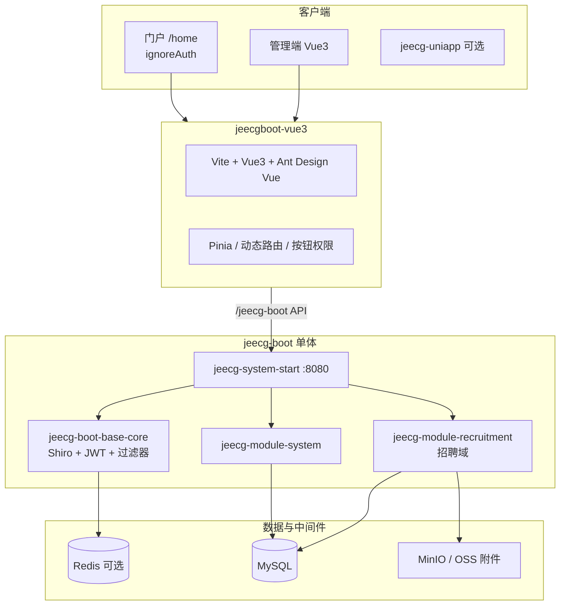

# xgsrms 项目文档索引

> **信工所招聘管理系统** — 基于 JeecgBoot 3.9.1 的低代码 + 定制招聘业务。

## 快速导航

| 主题 | 笔记 |
|------|------|
| 项目是什么 | [[01-项目总览]] |
| 技术架构 | [[02-技术栈与架构]] |
| 代码放哪 | [[03-源码目录结构]] |
| 业务流程 | [[04-招聘业务域]] |
| 后端接口 | [[05-后端API清单]] |
| 前端页面 | [[06-前端页面映射]] |
| 角色权限 | [[07-角色与权限]] |
| 部署上线 | [[08-部署与运维]] |
| 安全测试 | [[09-安全与扫描]]（**Agent 记忆** + L3 E2E） |
| **生产扫描报告** | [[12-生产环境安全扫描报告-2026-06-01]] |
| 本地开发 | [[10-开发指南]] |
| **代码图谱（CodeGraph）** | [[11-代码图谱与CodeGraph]] |

## 系统全景（Mermaid）

## 仓库与远端

| 项 | 值 |
|----|-----|
| 本地路径 | `I:\cursorProjects\xgsrms` |
| 腾讯工蜂 | `origin` → recruiting/xgsrms |
| GitHub 镜像 | `github` → yunfanleoq/xgsrms |
| 生产示例 | `http://10.28.12.15/`（以单位部署为准） |

## 相关外部链接

- [JeecgBoot 文档](https://help.jeecg.com)
- 仓库根 [[../UPGRADE-JeecgBoot-3.9|UPGRADE-JeecgBoot-3.9.md]]
- 操作手册 [[../standard-manual/README|standard-manual]]
