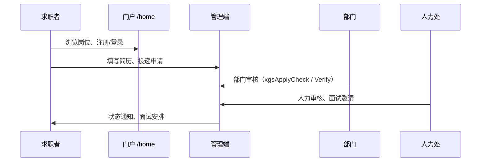

# 项目总览

← [[00-Index]]

## 项目名称与定位

- **仓库名**：`xgsrms`（XGS Recruitment Management System）
- **产品名**：信工所招聘管理系统
- **基座**：JeecgBoot **3.9.1**（Spring Boot 3.5 + JDK 17）
- **模式**：单体部署为主（`jeecg-system-start`），招聘能力由独立 Maven 模块 `jeecg-module-recruitment` 承载

## 子项目组成

| 目录 | 说明 |
|------|------|
| `jeecg-boot/` | 后端：系统管理 + **招聘模块** + 低代码/报表等 |
| `jeecgboot-vue3/` | 管理端与招聘门户前端（Vue3 + Vite） |
| `jeecg-uniapp/` | 移动端壳（可选，非主交付路径） |
| `docs/` | 升级说明、操作手册、安全扫描笔记 |
| `scripts/` | 构建、部署、数据库与安全脚本 |

## 核心业务闭环

## 用户角色（概要）

详见 [[07-角色与权限]]；操作细节见仓库 `docs/standard-manual/` 四分册。

| 角色 | 典型能力 |
|------|----------|
| 求职者 | 门户浏览、简历维护、岗位申请 |
| 部门管理员 | 本部门岗位与申请初审 |
| 人力处 | 招聘业务终审、面试、人才库 |
| 系统管理员 | 用户/角色/菜单/部门、系统配置 |

## 默认本地访问

| 服务 | 地址 |
|------|------|
| 后端 | `http://localhost:8080/jeecg-boot` |
| 前端 dev | `http://localhost:3100/` |
| 默认账号 | `admin` / `123456`（仅开发环境） |

## 关键定制标识

- 业务 API 前缀多为 `/xgs*`、`/positions/*`、`/resume/*`
- 前端视图目录以 `xgs*`、`positions*`、`home` 为主
- 表/实体前缀 `Xgs*`（如 `XgsPositionApply`、`XgsResumeBase`）
