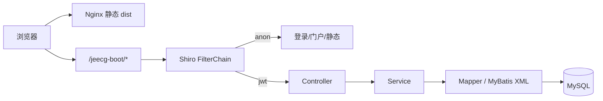

# 技术栈与架构

← [[00-Index]]

## 版本矩阵（当前仓库）

| 层 | 技术 | 版本/说明 |
|----|------|-----------|
| 后端框架 | Spring Boot | 3.5.5（parent POM） |
| 平台 | JeecgBoot | 3.9.1，`org.jeecgframework.boot3` |
| JDK | Java | **17**（POM `java.version`） |
| ORM | MyBatis-Plus | 3.5.12 |
| 权限 | Apache Shiro + JWT | 2.0.5 |
| API 文档 | Knife4j / springdoc | 4.5.0 |
| 报表 | JimuReport | 2.3.0 |
| 前端 | Vue 3 + TypeScript | `jeecgboot-vue3` package 3.7.2 显示名，对接 Boot 3.9 |
| 构建 | Vite 6 + Ant Design Vue 4 | Node 20+ |
| 包管理 | pnpm 9+ | 见 `jeecgboot-vue3/README` |
| 数据库 | MySQL | 5.7+，脚本在 `jeecg-system-start` resources |

## 架构形态

本仓库以 **单体** 为主，未强制启用 `jeecg-server-cloud` 微服务栈：

```
jeecg-boot-parent (pom)
├── jeecg-boot-base-core      # 工具、配置、Shiro、查询过滤器
├── jeecg-module-system       # 用户/角色/菜单/部门/字典…
│   └── jeecg-system-start    # 启动入口 :8080，依赖 recruitment
├── jeecg-boot-module         # 平台扩展模块
└── jeecg-module-recruitment  # ★ 招聘业务
```

启动类打包产物：`jeecg-system-start-3.9.1.jar`

## 请求链路



## 认证与签名

- 登录：`/sys/login`，Token 请求头 `X-Access-Token`
- 门户路由 `meta.ignoreAuth: true`（见 [[06-前端页面映射]]）
- 发布构建需 **前后端一致** 的 `JEECG_SIGNATURE_SECRET` / `VITE_GLOB_SIGNATURE_SECRET`（见 [[08-部署与运维]]）

## 与官方 JeecgBoot 的差异

| 项 | 本仓库 |
|----|--------|
| 业务模块 | 新增 `jeecg-module-recruitment` |
| 升级路径 | 自 3.7.2 → 3.9.1，见 `docs/UPGRADE-JeecgBoot-3.9.md` |
| 部署目标 | `xgs-server`，路径 `/www/wwwroot/rms/` |
| 双远端 | `origin` + `github` 同步推送 |

## 可选微服务（未作为主路径）

`jeecg-boot/jeecg-server-cloud/` 含 Nacos、Gateway、Sentinel 等；招聘生产环境按单体脚本部署。
