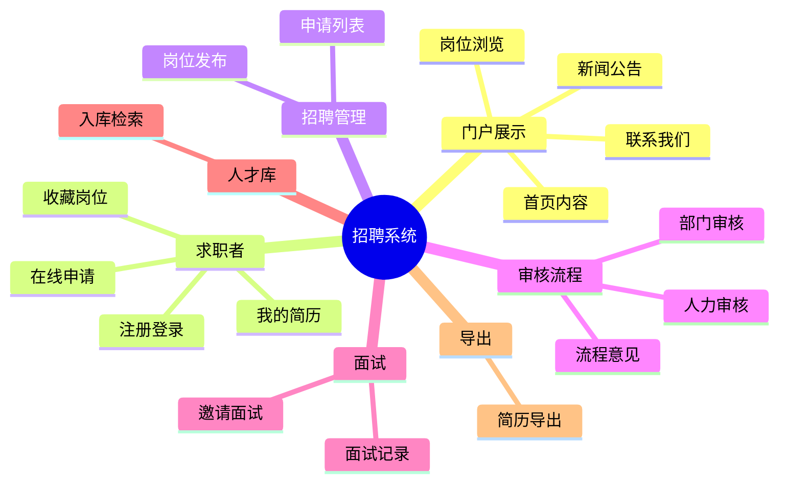
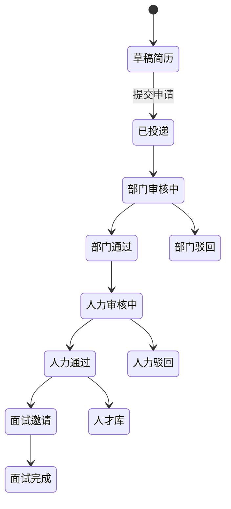

# 招聘业务域

← [[00-Index]] · 接口详见 [[05-后端API清单]] · 页面详见 [[06-前端页面映射]]

## 业务域划分

## 主流程状态（概念）

实际状态字段以 `XgsPositionApply` 及关联表为准，逻辑分布在：

- `XgsPositionsController`：`apply` / `check` / `post` 岗位生命周期
- `XgsPositionApplyController`：申请 CRUD 与列表权限
- `XgsFlowOpinionsController`：`submitByApplyId` 提交审核意见
- 前端 `xgsApplyVerify`：部门 `dep_verify`、人力 `rcl_verify` 分栏

## 简历类型（多表策略）

Jeecg 代码生成 + 手工扩展，按招聘岗位/人员类别分表维护：

| 类型代码 | Controller 路径 | 典型场景 |
|----------|-----------------|----------|
| PT（普通） | `/xgsResume/xgsResumeBase` | 一般岗位 |
| FG | `/xgsResume/xgsResumeFG` | 副高/特定类别 |
| TJ | `/xgsResume/xgsResumeTJ` | 推荐/特殊通道 |
| BSH | `/xgsResume/xgsResumeBSH` | 博士后 |

关联子表：`XgsResumeEdus`、`XgsResumeWorks`、`XgsResumeHome` 等。

## 门户 vs 管理端

| 维度 | 门户 `/home/*` | 管理端 |
|------|----------------|--------|
| 认证 | 多数 `ignoreAuth` | JWT + 菜单权限 |
| 用户 | 求职者、访客 | 部门/人力/管理员 |
| 岗位 | 公开列表、详情 | 发布、审核、统计 |
| 简历 | 在线填写、PDF 上传 | 审批、导出、人才库 |

## 文件与简历解析

- `XgsMyresumeController`：`/uploadPdf` 上传 PDF 简历
- `XgsUserResumeFileController`：`/analysisResume` 解析附件
- 静态资源与大屏 demo 在模块 `resources/static/bigscreen/`（与生产招聘弱相关）

## 与低代码的关系

模块内保留 `org.jeecg.modules.demo`（Online 表单 demo、mock JSON）。**生产招聘功能以 `recruitment` 包为准**，demo 勿当作业务入口。
