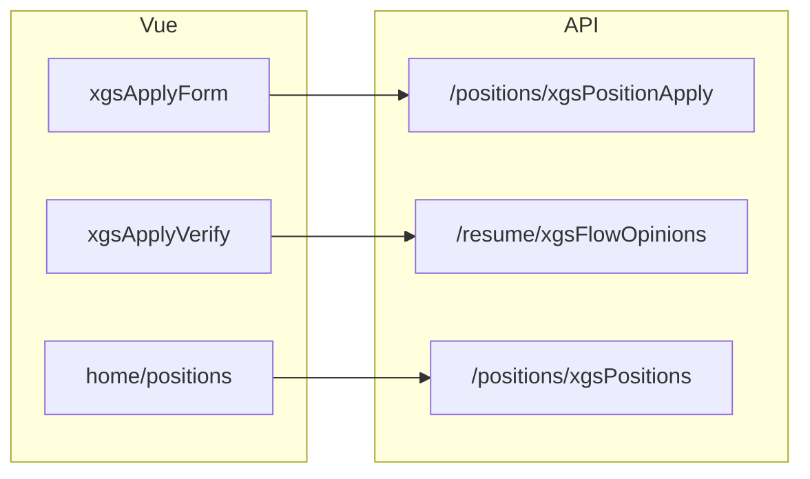

# 前端页面映射

← [[00-Index]] · API 见 [[05-后端API清单]]

## 技术要点

| 项 | 路径/说明 |
|----|-----------|
| 入口 | `jeecgboot-vue3/src/main.ts` |
| 路由 | `src/router/` — 静态路由 + 后端动态菜单 |
| API 封装 | 各视图下 `*.api.ts` |
| 表格/表单 | `*.data.ts` + `components/*Modal.vue` |
| 环境变量 | `.env.development` / `VITE_GLOB_*` |

## 门户路由（无需登录）

定义于 `src/router/routes/index.ts` → `homeIndexRoute`：

| path | 页面 | title |
|------|------|-------|
| `/home/index` | `home/home.vue` | 招聘首页 |
| `/home/positions` | `home/positions.vue` | 招聘岗位 |
| `/home/positions/positionDetail/:id` | `home/positionDetail.vue` | 岗位明细 |
| `/announcement/:id` | `home/announcementDetail.vue` | 招聘信息 |
| `/home/news`、`/news/:id` | 新闻列表/详情 | 科研发展 |
| `/home/contactUs` | `contactUs.vue` | 联系我们 |
| `/home/ygqk`、`/home/yjsk` | 员工情况、研究所况 | 门户栏目 |

`meta.ignoreAuth: true` — 与 Shiro anon 配置需保持一致（见 [[09-安全与扫描]]）。

## 管理端视图目录 → 业务

| views 目录 | 业务 |
|------------|------|
| `xgsApplyForm` | 在线填写申请表 |
| `xgsMyresume` | 求职者简历维护 |
| `postionsPost` | 岗位发布 |
| `positions` | 岗位管理、申请列表 |
| `positionsCheck` | 岗位审核 |
| `xgsApplyCheck` | 申请复核 |
| `xgsApplyVerify/dep_verify` | 部门待办/已办 |
| `xgsApplyVerify/rcl_verify` | 人力待办/已办 |
| `xgsResumeApproval` | 简历审批 |
| `xgsResumeBase` | 简历库（分 PT/FG/TJ/BSH 子目录） |
| `xgsRecruitment` | 招聘业务汇总 |
| `xgsInviteToInterview` | 发面试邀请 |
| `xgsMyInterview` | 面试方/候选人面试视图 |
| `xgsTalentpool` | 人才库 |
| `xgsHome` / `xgsJournalism` / `xgsIntroduce` / `xgsContactUs` | CMS 类配置 |
| `userPositions` | 用户侧岗位/收藏简历 |
| `home/position` | 门户岗位数据配置 |

菜单 **名称与 component 路径** 以数据库 `sys_permission` 为准；改菜单后需同步 SQL 或后台「菜单管理」。

## 典型前后端对应



## E2E 测试

`package.json`：

```bash
pnpm test:e2e          # playwright tests/e2e/resume-submit.spec.ts
```

详见 `docs/自动化测试方案.md`。

## 构建产物

- `pnpm run build` → `dist/`
- 部署脚本：`jeecgboot-vue3/scripts/deploy-frontend-xgs-server.ps1` → [[08-部署与运维]]
