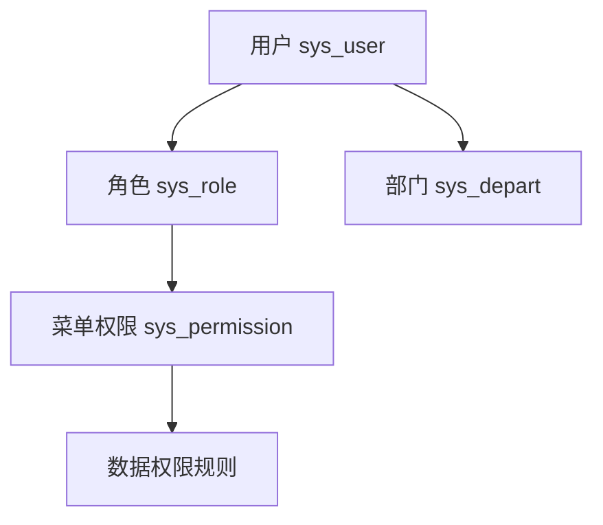

# 角色与权限

← [[00-Index]]

## 角色分册（操作手册）

仓库 `docs/standard-manual/` 已按角色拆分，可生成 Word：

| 角色 | Markdown |
|------|----------|
| 求职者 | `01-求职者操作手册.md` |
| 部门审核 | `02-部门审核操作手册.md` |
| 人力处 | `03-人力处审核操作手册.md` |
| 系统管理员 | `04-系统管理员操作手册.md` |

生成 Word：`python scripts/md_to_docx_manual.py`

## 权限模型（Jeecg 标准 + 定制）

- **菜单权限**：控制路由是否可见
- **按钮权限**：`v-auth` / 权限码，控制增删改导出
- **数据权限**：按部门、用户过滤列表 SQL

## 招聘相关权限注意点

1. **岗位申请列表**：部门账号仅能看本部门数据（需后端 QueryGenerator + 数据规则）
2. **人力处**：跨部门汇总、终审、面试、人才库
3. **求职者**：门户 + 「我的简历」；不应访问管理端审批接口
4. 补丁 SQL：`scripts/sql/mysql/xgs_grant_position_apply_list_permission.sql`
5. 菜单变更记录：`docs/菜单权限需执行语句.txt`

## 前端权限表现

- 登录后 `getUserPermissionByToken` 拉取路由与按钮码
- 无权限路由跳转 403
- 门户路由单独配置 `ignoreAuth`（[[06-前端页面映射]]）

## 测试账号规划

`docs/系统角色及测试计划.md`（若为空，测试时按四分册角色在测试环境建号）。

建议矩阵：

| 账号类型 | 验证点 |
|----------|--------|
| 求职者 A/B | 仅能改自己的简历与申请 |
| 部门甲/乙 | 不能互看对方部门申请 |
| 人力 | 可见全部待审、可发面试邀请 |
| admin | 菜单配置、用户同步 |
