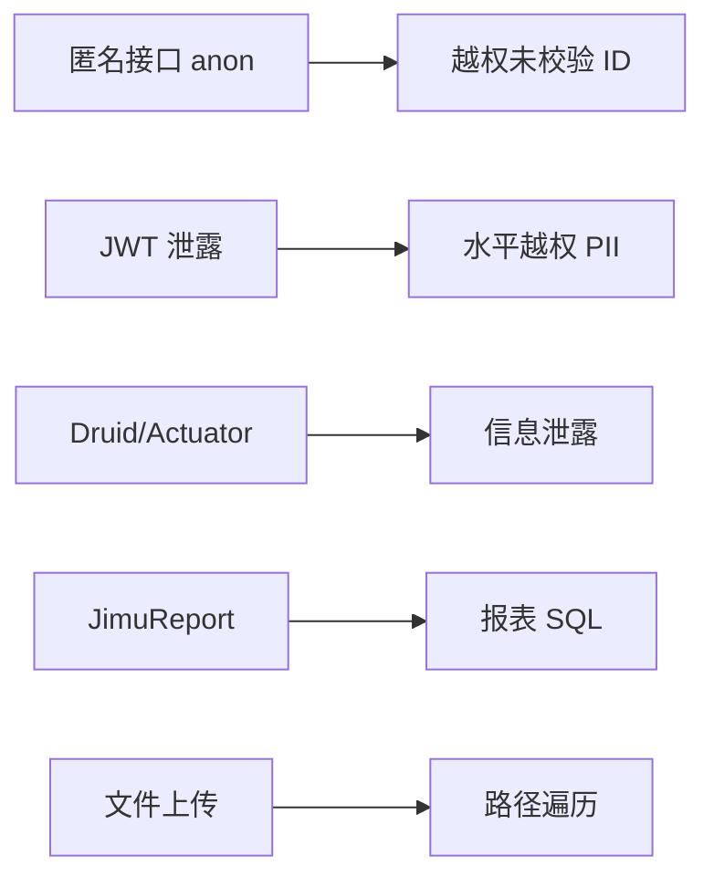

# 安全与扫描

← [[00-Index]]

> **Agent 记忆文档**：本文档 + 全局 Skill `jeecg-webapp-security-scan` 为安全扫描的持久知识库。2026-06-01 L3 E2E 全量通过后已固化。

## 文档与技能

| 资源 | 位置 |
|------|------|
| Cursor 扫描技能（仓库索引） | `docs/cursor-skill-jeecg-security-scan.md` |
| 用户技能（全局） | `%USERPROFILE%\.cursor\skills\jeecg-webapp-security-scan\` |
| **L3 E2E 自动化** | Skill 内 `e2e-automation.md` |
| **修复 Playbook** | Skill 内 `fixes-playbook.md` |
| 漏洞汇总材料 | `Fw_ 招聘系统漏洞报告及测试记录/` |
| Shiro 补丁片段 | `docs/merge-patches/shiro-xgs-anon-snippet.java` |
| 验证脚本 | `scripts/security-remediation-verify.ps1` |

## L3 E2E 安全回归（2026-06-01 固化）

### 结果摘要

| 阶段 | 通过 |
|------|------|
| setup（六角色 OCR 登录） | 6/6 |
| security（Authz + File + Rep + Auth-02 + Api-03） | 18/18 |
| **合计** | **24/24** |

### 命令

```powershell
Set-Location I:\cursorProjects\xgsrms\jeecgboot-vue3
npm run test:e2e:security:full
```

前置：`E2E_BASE_URL=https://10.28.12.15`；后端 `curl -sk .../sys/randomImage/test` 非 502。

### 用例与 spec 对照

| 编号 | spec | 要点 |
|------|------|------|
| Authz-01～06 | `security/authz-idor.spec.ts` | 多角色 JWT API；exportXls 曾 IDOR，已修 |
| File-01～04 | `security/file-upload.spec.ts` | SsrfFileTypeFilter；OSS 403；Jsoup 富文本 |
| Rep-02/03 | `security/rep-admin.spec.ts` | `/jmreport/testConnection`、`queryFieldBySql` |
| Auth-02 | `security/auth-enumeration.spec.ts` | checkOnlyUser + login 统一文案 |
| Api-03 | `security/api-rate-limit.spec.ts` | probe 账号 6 次失败锁定 |

### E2E helpers（勿删改逻辑时不测）

| 文件 | 职责 |
|------|------|
| `helpers/api-auth.ts` | JWT 从 `.auth` 解析；`isAccessDenied`（含「没有权限」） |
| `helpers/captcha-api.ts` | API 验证码 + ddddocr |
| `helpers/login-api.ts` | RSA 登录、checkOnlyUser |
| `helpers/api-upload.ts` | multipart 上传 |

### JWT 读取坑（必记）

- 路径：`jeecgboot-vue3/.auth/{account}.json`（`process.cwd() + '.auth'`）
- Token 在 `COMMON__LOCAL__KEY__` JSON 桶内 `TOKEN__.value`，非裸 key
- Jeecg 无权限常 **HTTP 200 + code 510**，勿只断言 403

### 测试账号

| 账号 | 密码 | 用途 |
|------|------|------|
| test-qz / test-qz-b | `{名}@2026` | 求职者 IDOR |
| test-bm / test-bm-b | `{名}@2026` | 部门 / File-04 |
| test-rl | test-rl@2026 | 人事 |
| admin | zktw@2019 | Rep、对照 |

预置：`scripts/seed_test_users.py` → `scripts/sql/mysql/xgs_seed_test_users.generated.sql`

---

## Agent 记忆要点（经生产验证）

### 1. Authz-03 exportXls IDOR（已修复）

- **漏洞**：`positions:xgs_position_apply:exportXls` 仅菜单权限，`selections=他人ID` 可导出
- **修复**：`XgsRecruitmentAuthUtil.assertCanExportApply` 去掉 `canExportApplies()` 单独放行；Controller 对 selections 逐条校验
- **部署**：改 Java 后须上传 JAR + `sudo restart-rms-backend.sh`（自动化 scp 后 sudo 需人工）

### 2. JimuReport（Rep-02/03）

- Shiro：`/jmreport/**` → `jwt,roles[admin]`；test-qz 得「没有权限」
- 路径：`POST /jmreport/testConnection`、`POST /jmreport/queryFieldBySql`
- 生产：`lowCodeMode=prod`、`dataSourceSafe=true`、`api-ssrf-guard-enabled=true`

### 3. 文件与 XSS（File）

- 白名单：`SsrfFileTypeFilter`（无 svg/html/jsp）
- 管理上传：`/sys/oss/file/upload` 需 `system:ossFile:upload`
- 富文本：`XgsPositionInputSanitizer` 在 Service save/update

### 4. 枚举与限流（Auth-02 / Api-03）

- checkOnlyUser：须验证码；message 统一「校验完成」
- login：不存在/密码错误均「用户名或密码错误」
- Api-03：`e2e-ratelimit-{ts}` probe，≥6 次失败 →「登录失败次数过多」

### 5. 生产部署踩坑

| 问题 | 处理 |
|------|------|
| 脚本 CRLF | `sed -i 's/\r$//'` |
| sudo 密码 | 仅 scp 可自动化 |
| restart `$HOME` | 用 `SCRIPT_DIR` 定位脚本 |
| 502 | `stop-rms-backend.sh` 后再 start |

### 6. 仍属信息项（非漏洞）

- FE-INFO-01/02：`_app.config.js` 含 cas.test.com、localhost 占位
- HTTPS 自签：Playwright `ignoreHTTPSErrors: true`

---

## 架构面风险面（JeecgBoot + 招聘）



## 本项目的重点审计项

### 1. 认证链（Shiro）

- 配置类：`jeecg-boot-base-core/.../ShiroConfig.java`
- 门户/静态资源 anon 与 `/**` 顺序敏感（注释 C-003）
- 登录：RSA `/sys/loginRsaPublicKey`、注册 `/sys/user/register`

### 2. 招聘 IDOR / 水平越权

对以下接口用 **A 用户 Token 访问 B 用户数据** 复测（已由 Authz E2E 覆盖）：

- `/xgsResume/*`、`/positions/xgsPositionApply/*`
- `/resume/xgsUserResumeFile/*`
- `/xgsMyresume/*` 的 `uploadPdf`、`queryById`

### 3. 门户 ignoreAuth

前端 `homeIndexRoute` 与后端 anon 应对齐；避免「仅前端隐藏、接口仍裸奔」。

### 4. 签名密钥

`JEECG_SIGNATURE_SECRET` 与前端 `VITE_GLOB_SIGNATURE_SECRET` 必须一致；**禁止**提交 `local-signature.env`。

### 5. 平台组件

- Druid 监控路径
- JimuReport `/jmreport/**`
- 代码生成器、Online 表单
- `checkOnlyUser` 用户枚举（E2E `auth-enumeration.spec.ts`）

## 扫描工作流（建议）

1. **静态**：按 SKILL grep 目标扫 `jeecg-boot`、`jeecg-module-recruitment`
2. **配置**：核对 `application-prod.yml`、Nginx、CORS、`rms.env`
3. **动态 DAST**：curl + 双角色 Token
4. **L3 E2E**：`npm run test:e2e:security:full`（见上）
5. **回归**：`security-remediation-verify.ps1`
6. **记录**：PROJ-xxx / VULN-xxx → 汇总表 + [[12-生产环境安全扫描报告-2026-06-01]]

## 生产扫描报告

| 报告 | 说明 |
|------|------|
| [[12-生产环境安全扫描报告-2026-06-01]] | 2026-06-01 生产全量复测；**L3 24/24 闭环** |

## 敏感数据

招聘系统含 **PII**（身份证、联系方式、简历附件）。日志、导出、人才库导出需脱敏与权限最小化。
