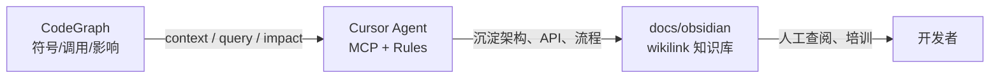

# 代码图谱与 CodeGraph

← [[00-Index]] · 配合 [[05-后端API清单]]、[[06-前端页面映射]]

## 索引概况（本机已构建）

| 指标 | 数值 |
|------|------|
| 已索引文件 | 3,138 |
| 符号节点 | 49,577 |
| 关系边 | 60,450 |
| 索引库大小 | ~119 MB（`.codegraph/`，已加入 `.gitignore`） |
| 后端 | node:sqlite WAL |

### 语言分布（Top）

| 语言 | 文件数 |
|------|--------|
| Java | 1,058 |
| Vue | 1,042 |
| TypeScript | 678 |
| JavaScript | 151 |
| XML（含 MyBatis） | 136 |

招聘核心代码主要在 `jeecg-module-recruitment`（Java）与 `jeecgboot-vue3/src/views/xgs*`（Vue/TS）。

## 三层协作：CodeGraph → Cursor → Obsidian



| 步骤 | 工具 | 动作 |
|------|------|------|
| 1 | CodeGraph CLI | `codegraph status` / `sync` 保持索引新鲜 |
| 2 | Cursor MCP | `codegraph_context`、`codegraph_search` 等（见下表） |
| 3 | Obsidian | 将结论写入本库，用 `[[wikilink]]` 串联 |

## 项目 Obsidian MCP

| 服务名 | 路径 |
|--------|------|
| `obsidian-vault` | `docs/obsidian/`（仅本仓库，见 `docs/mcp/README.md`） |

Agent 写文档时用该 MCP，不要用全局里其他项目的 Obsidian 配置。

## Cursor 集成状态

已在项目执行：

```powershell
Set-Location I:\cursorProjects\xgsrms
codegraph init --index
codegraph install -t cursor -l local -y
```

生成（目录 `.cursor/` 默认被 `.gitignore` 忽略，换机需重装）：

- `.cursor/mcp.json` — MCP `codegraph` + `--path` 指向本仓库
- `.cursor/rules/codegraph.mdc` — Agent 工具选用规范

**换机或新克隆后**：在仓库根目录重新执行上述两条命令。

## MCP 工具速查（意图 → 工具）

| 问题 | MCP 工具 |
|------|----------|
| 符号在哪、签名是什么 | `codegraph_search` |
| 某功能/任务的整体上下文 | `codegraph_context` |
| 谁调用了 X | `codegraph_callers` |
| X 调用了谁 | `codegraph_callees` |
| 改 X 会影响什么 | `codegraph_impact` |
| 看多个相关符号源码 | `codegraph_explore` |
| 目录下有哪些文件 | `codegraph_files` |
| 索引是否过期 | `codegraph_status` |

CLI 等价：`codegraph query`、`codegraph context`、`codegraph callers` 等（`codegraph trace` 仅部分 MCP 版本提供）。

## 招聘域：CodeGraph 实证摘录

### 岗位申请 — 后端入口

`codegraph query "XgsPositionApplyController"` 命中：

| 方法 | 行号 | 说明 |
|------|------|------|
| `doPositionApply` | 205 | 投递主流程 |
| `add` | 190 | 新增申请 |
| `checkApplyByPosId` | 241 | 按岗位校验 |
| `listMine` | 55 | 我的申请列表 |
| `queryPageList` | 82 | 分页列表（权限敏感） |

`codegraph impact "XgsPositionApplyController"` → 控制器内 16 个符号（类、注入 Service、全部 REST 方法）。

实体表：`xgs_position_apply`（`XgsPositionApply` entity）。

### 岗位申请 — 前端 API 复用点

多个视图各自维护 `XgsPositionApply.api.ts`，均指向同一后端前缀 `/positions/xgsPositionApply/`：

| 前端路径 | 用途 |
|----------|------|
| `views/home/position/` | 门户投递 |
| `views/xgsRecruitment/` | 招聘管理 |
| `views/positions/` | 岗位与申请 |
| `views/xgsApplyCheck/departApproval/` | 部门审批 |
| `views/xgsResumeApproval/hrApproval/` | 人力审批 |

门户典型接口（见 `home/position/XgsPositionApply.api.ts`）：

- `GET .../list`
- `POST .../doPositionApply`
- `POST .../add`

### 门户鉴权辅助类

`codegraph context "recruitment security"` 发现：

- `RecruitmentPortalAuthUtil`（`recruitment/security/`）
  - `tryGetLoginUser` — 从请求解析 JWT
  - `isRecruitmentPrivileged` — 角色含 `admin` 或 `depart_position_manager`

与 [[07-角色与权限]]、[[09-安全与扫描]] 的门户/越权测试相关。

## 常用 CLI 命令（维护文档时用）

```powershell
Set-Location I:\cursorProjects\xgsrms

codegraph status
codegraph sync                    # 大批量改代码后
codegraph context "关键词或任务描述"
codegraph query "类名或方法名"
codegraph impact "XgsFlowOpinionsController"
codegraph files --pattern "**/recruitment/**"
```

## 文档更新工作流（Agent Skill）

仓库技能说明：`docs/cursor-skill-codegraph-obsidian.md`

1. 用 CodeGraph 回答「结构/流程/影响面」问题  
2. 将**可复现**的结论（表名、类名、路径、调用链）写入本 Obsidian 库  
3. 大改模块后执行 `codegraph sync` 并刷新 [[05-后端API清单]] 或本篇

## 限制

- 索引滞后约 1s；工具响应若带 stale 文件列表，对该文件用 Read 核对  
- Java Spring 注入、反射、MyBatis XML 动态 SQL：跨文件边为**最佳努力**  
- 不能替代编译器与集成测试
