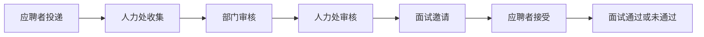
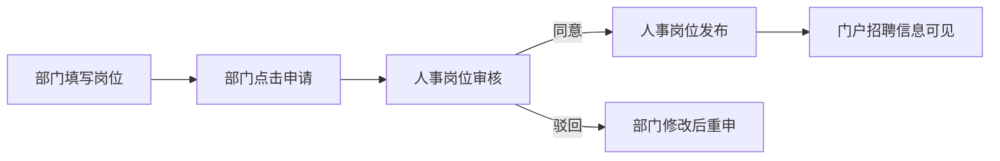

# 招聘系统操作总册

## 文档信息

| 项目 | 说明 |
|------|------|
| 文档版本 | 1.0 |
| 适用范围 | 信工所招聘管理系统（门户 + 管理端） |
| 正式环境 | `https://10.28.12.15/`（内网，需 VPN） |
| 关联分册 | [01 求职者](01-求职者操作手册.md) · [02 部门](02-部门审核操作手册.md) · [03 人力处](03-人力处审核操作手册.md) · [04 管理员](04-系统管理员操作手册.md) |

本总册把**角色 × 页面 × 主状态流转**钉死；操作细节以分册为准，避免重复长文。

---

## 1. 角色定义与账号矩阵

| 业务称呼 | 系统角色 | 典型测试账号 | 主要入口 |
|---------|---------|-------------|---------|
| 应聘者 / 求职者 | 求职者 | `test-qz` | 门户投递、个人中心 |
| 部门招聘主管 | 部门岗聘主管 | `test-bm` | 发布申请、部门审核 |
| 人事处招聘主管/专员 | 人事处 | `test-rl` | 人力处收集/审核、岗位审核与发布、面试 |
| 系统管理员 | admin | `admin` | 用户/角色/菜单、系统配置 |

密码与预置说明见 `docs/系统角色及测试计划.md`、`docs/测试账号预置指南.md`（自动化用环境变量，勿把口令写入文档正文以外的仓库文件）。

能力对照（摘要）：

| 能力 | 应聘者 | 部门 | 人事处 | admin |
|------|--------|------|--------|-------|
| 门户浏览 / 在线申请 | ✅ | — | — | — |
| 我的申请 / 我的面试 | ✅ | — | — | — |
| 岗位发布申请 | — | ✅ | — | ✅ |
| 岗位审核 / 发布 | — | — | ✅ | ✅ |
| 人力处收集 / 人力处审核 | — | — | ✅ | ✅ |
| 部门审核 | — | ✅ | — | ✅ |
| 面试邀请 / 通过·未通过 | — | — | ✅ | ✅ |
| 招聘智能体 / 本体 | — | 视授权 | ✅ | ✅ |

---

## 2. 页面地图

### 2.1 门户（应聘者为主）

| 页面 | 路径（示意） | 说明 |
|------|-------------|------|
| 招聘首页 | `/home/index` | 栏目与公告 |
| 招聘岗位列表 | `/home/positions` | 在招岗位 |
| 岗位详情 | `/home/positions/positionDetail/:id` | 【在线申请】入口 |
| 登录 / 注册 | `/login` 等 | 图形验证码以环境配置为准 |

### 2.2 求职者后台（个人中心）

| 菜单 | 说明 |
|------|------|
| 我的申请 | 投递记录与审核状态 |
| 我的面试 | 接受 / 拒绝面试邀请 |
| 我的简历 | 简历维护（可上传 PDF 自动填充） |

### 2.3 部门侧

| 菜单路径 | 说明 |
|----------|------|
| 岗位发布管理 → 发布申请 | 新增岗位并【申请】 |
| 岗位发布管理 → 综合查询 | 本部门岗位状态 |
| 简历审核管理 → 部门审核 | 对人力处收集通过后的申请审核 |

### 2.4 人事处侧

| 菜单路径 | 说明 |
|----------|------|
| 岗位发布管理 → 岗位审核 / 岗位发布 | 审核岗位并上线 |
| 简历审核管理 → 人力处收集 | 简历初审 |
| 简历审核管理 → 人力处审核 | 部门通过后的终审 |
| 面试管理 → 面试邀请 / 综合查询 | 发邀请、记通过/未通过 |
| 招聘智能体 → 工作流/本体 | 智能体看板与本体论（见第 6 节） |

更细的视图目录映射见 `docs/obsidian/06-前端页面映射.md`。

---

## 3. 主流程（简历审核链路）

与三分册、E2E `recruitment-full-chain` **一致**的顺序：

| 节点 | 角色 | 菜单路径 | 状态含义（概念） |
|------|------|----------|------------------|
| 投递 | 应聘者 | 门户岗位详情 → 在线申请 | 已投递，进入人力处收集池 |
| 人力处收集 | 人事处 | 简历审核管理 → 人力处收集 | 同意 → 部门审核；驳回 → 流程终止/退回 |
| 部门审核 | 部门 | 简历审核管理 → 部门审核 | 同意 → 人力处审核 |
| 人力处审核 | 人事处 | 简历审核管理 → 人力处审核 | 同意 → 可发面试邀请 |
| 面试邀请 | 人事处 | 面试管理 → 面试邀请 | 填写时间/地点/说明并发送 |
| 接受邀请 | 应聘者 | 个人中心 → 我的面试 | 接受后进入待面试结论 |
| 面试结果 | 人事处 | 面试管理 → 面试邀请（通过/未通过） | 写入「面试通过」或「面试未通过」 |

> **注意：** 不要把「部门审核」写在「人力处收集」之前。历史笔记若写反，以本总册与 `03-人力处审核操作手册` 为准。

---

## 4. 岗位发布子流程（与简历审核分开）

| 步骤 | 角色 | 菜单 |
|------|------|------|
| 新增 / 编辑 / 申请 | 部门 | 岗位发布管理 → 发布申请 |
| 同意 / 驳回 | 人事处 | 岗位发布管理 → 岗位审核 |
| 发布上线 | 人事处 | 岗位发布管理 → 岗位发布 |

岗位须 **审核通过 → 发布** 后，应聘者才能在「招聘信息」中投递。

---

## 5. 分册索引

| 分册 | 读者 | 内容重心 |
|------|------|----------|
| [01-求职者操作手册](01-求职者操作手册.md) | 应聘者 | 浏览、投递、我的申请/面试 |
| [02-部门审核操作手册](02-部门审核操作手册.md) | 部门招聘主管 | 发布申请、部门审核 |
| [03-人力处审核操作手册](03-人力处审核操作手册.md) | 人事处 | 岗位审核发布、人力收集/审核、面试 |
| [04-系统管理员操作手册](04-系统管理员操作手册.md) | admin | 用户角色菜单、运维入口 |

测试用例与计划：`docs/testcases/招聘主流程测试用例.md`、`docs/testcases/招聘主流程测试计划.md`。

---

## 6. 招聘智能体 / 本体论（后台菜单）

后台增加父菜单 **「招聘智能体」**，子菜单 **「工作流/本体」**：

- 组件：`rmsAgent/RmsAgentWorkflow`
- 静态兜底路由：`/rms/agent-workflow`
- 授权：`admin` + 人事处角色（种子 SQL：`scripts/sql/mysql/xgs_seed_rms_agent_menu.sql`）

页面含两个模式：

1. **工作流**：按阶段办理投递后链路（初筛、部门、决审、邀请、面试结论），动作仍写入原申请/邀请表。
2. **本体**：查看智能体、对象、关系、动作与工具目录。

部门审核、人力审核、面试邀请等列表页也可内嵌同一工作流组件；独立菜单便于人事处从侧栏直达。

生产执行菜单种子后，相关用户需**重新登录**刷新权限。

---

## 7. 简历 PDF 自动填充（默认本地 Tika）

| 模式 | 配置 | 说明 |
|------|------|------|
| **tika（默认）** | `resume.parse.mode=tika` | Apache Tika 抽 PDF 文本 + 规则映射 JSON 模板；**不要求**智谱 `ClientV4` |
| zhipu（可选） | `resume.parse.mode=zhipu` | 上传智谱 + GLM 抽取；需配置 ClientV4 |

门户「在线申请」精简必填：基本信息、教育经历、工作经历、登记照、附件；家庭状况、业绩、陈述等冷门块默认折叠。

---

## 8. 修订说明

| 日期 | 说明 |
|------|------|
| 2026-11-01 | 首版总册：对齐真实审核顺序；链到 01~04；增加智能体菜单与 Tika 默认说明 |
