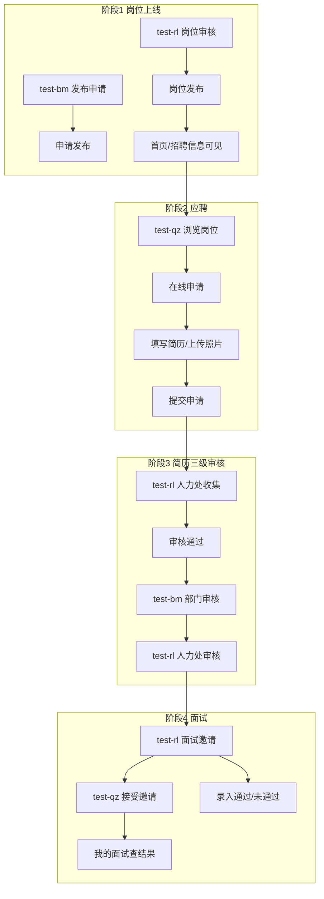

# 信工所招聘管理系统 — 自动化与完备性测试方案

> 依据：操作手册四分册、录屏分析、[[系统角色及测试计划]]、[[同类应用系统-安全扫描策略]]  
> 目标：**按招聘全业务流程做功能完备性测试**，并衔接 **Authz / File / Rep / Auth / Api** 安全回归项。  
> 密码规则：业务账号 `{用户名}@2026`；管理员 `admin` → `zktw@2019`

---

## 一、测试用户（摘要）

完整矩阵见 **`docs/系统角色及测试计划.md`**。

| 角色 | 账号 | 密码 | 状态 |
|------|------|------|------|
| 求职者 A | `test-qz` | `test-qz@2026` | ✅ |
| 求职者 B（IDOR） | `test-qz-b` | `test-qz-b@2026` | ✅ |
| 部门 A | `test-bm` | `test-bm@2026` | ✅ |
| 部门 B（IDOR） | `test-bm-b` | `test-bm-b@2026` | ✅ |
| 人事处 | `test-rl` | `test-rl@2026` | ✅ |
| 系统管理员 | `admin` | `zktw@2019` | Rep-02/03、环境初始化 |

---

## 二、全业务流程（完备性测试主干）

与操作手册、录屏、[[04-招聘业务域]] 状态机对齐。



### 2.1 阶段明细与断言

| 阶段 | 角色 | 菜单路径（以实际为准） | 关键断言 |
|------|------|------------------------|----------|
| 1.1 新增岗位 | test-bm | 岗位发布管理 → 发布申请 → 新增 | 必填项校验；保存成功；列表可见草稿 |
| 1.2 申请发布 | test-bm | 同上 → 操作「申请」 | 状态变为待审核 |
| 1.3 岗位审核 | test-rl | 岗位审核 | 审核通过 |
| 1.4 岗位发布 | test-rl | 岗位发布 | 发布后门户 `/home/positions` 可检索 |
| 2.1 浏览投递 | test-qz | 首页 → 招聘信息 → 详情 → 在线申请 | 未登录引导登录；已登录进入申请表 |
| 2.2 简历填写 | test-qz | 多段式表单 + 照片上传 | JPG/PNG ≤2MB；提交成功 |
| 2.3 防重复投递 | test-qz | 同一岗位再次申请 | 拒绝或按钮不可用 |
| 3.1 人力收集 | test-rl | 简历审核 → 人力处收集 | 可见新申请；可操作审核 |
| 3.2 部门审核 | test-bm | 简历审核 → 部门审核 | 仅本部门数据；状态流转正确 |
| 3.3 人力终审 | test-rl | 简历审核 → 人力处审核 | 通过后进入可邀请池 |
| 4.1 面试邀请 | test-rl | 面试管理 → 面试邀请 | 邀请状态：待邀请→已发送 |
| 4.2 接受邀请 | test-qz | 个人中心 → 我的面试 | 接受/拒绝成功 |
| 4.3 面试结论 | test-rl | 面试邀请 → 通过/未通过 | 与 test-qz 端展示一致 |
| 4.4 我的申请 | test-qz | 个人中心 → 我的申请 | 状态与后台节点一致 |

### 2.2 录屏已覆盖 / 待补页面

| 页面 | 路由示例 | 录屏 |
|------|----------|------|
| 发布申请 | `/positions/xgsPositionPublishList` | ✅ frame_001 |
| 求职者登录/简历 | `/login`, 申请表单 | ✅ frame_002/003 |
| 面试邀请 | `/xgsinviteToInterview/xgsinviteToInterviewList` | ✅ frame_005 |
| 岗位审核、岗位发布、人力处收集 | 各 `*Check*` / `*Verify*` 路由 | ❌ 待 E2E 补全 |

---

## 三、测试分层与工具

| 层级 | 范围 | 工具 | 执行环境 |
|------|------|------|----------|
| **L1 冒烟** | 各角色登录、核心菜单可见 | Playwright | 10.28.12.15 或本地代理 |
| **L2 E2E 完备性** | §二 全链路 E2E-01～E2E-08 | Playwright 多角色 `storageState` | 测试环境；串行 |
| **L3 安全回归** | Authz/File/Rep/Auth/Api 阻塞项 | Playwright `request` + curl + 选手工 | 预发优先；生产仅只读/单条 |
| **L4 API 状态机**（可选） | 审核/发布/面试状态接口 | Playwright request / JUnit | 与 L2 共用 Token |

**现有代码衔接**

- 配置：`jeecgboot-vue3/playwright.config.ts`
- 示例：`jeecgboot-vue3/tests/e2e/resume-submit.spec.ts`
- 目标目录：`jeecgboot-vue3/tests/e2e/` + `tests/security/`（待建）

---

## 四、E2E 用例清单

| ID | 名称 | 角色顺序 | 依赖数据 | 主要断言 |
|----|------|----------|----------|----------|
| E2E-01 | 岗位从创建到发布 | test-bm → test-rl | 部门/岗位分类 | 发布后门户可见 |
| E2E-02 | 求职者投递 | test-qz | E2E-01 已发布岗位 | 提交成功；材料上传 OK |
| E2E-03 | 不可重复投递 | test-qz | E2E-02 同岗位 | 二次投递被拒绝 |
| E2E-04 | 简历三级审核 | test-rl → test-bm → test-rl | E2E-02 申请 | 各节点状态与手册一致 |
| E2E-05 | 面试邀请与接受 | test-rl → test-qz | E2E-04 终审通过 | 邀请发出；接受成功 |
| E2E-06 | 面试结论与查询 | test-rl → test-qz | E2E-05 | 通过/未通过两端一致 |
| E2E-07 | 我的申请/面试只读 | test-qz | 全流程后 | 列表字段、状态正确 |
| E2E-08 | 门户与后台切换 | test-qz / test-bm | — | 返回首页、个人中心、菜单权限 |

**实现顺序**

1. `auth.setup.ts`：三角色 + admin 登录 → `.auth/*.json`（gitignore）
2. `flows/position-lifecycle.spec.ts`（E2E-01）
3. `flows/application-review-interview.spec.ts`（E2E-02～07）
4. 共用 fixture：岗位名称带时间戳，避免并行冲突

---

## 五、安全测试项（与上次阻塞对齐）

上次手工扫描阻塞项与本方案处理方式：

| 编号 | 检查项 | 上次状态 | 前置条件 | 自动化策略 | 通过标准 |
|------|--------|----------|----------|------------|----------|
| **Authz-01** | 用户/员工列表越权 | 阻塞：无 test-qz JWT | test-qz 可登录 | `request.get('/sys/user/list')` 低权限 Token | 403 或脱敏 |
| **Authz-02** | 简历 list vs listMine | 同上 | test-qz + test-qz-b | A 创建 → B 读/改 A 的 resumeId | 403 |
| **Authz-03** | 简历导出 Word/PDF | 同上 | 有效 applyId | B Token 枚举 A 的 applyId 导出 | 403 |
| **Authz-04** | 岗位/申请全量列表 | 同上 | test-qz | 不传审批节点、换 dept 参数 | 无他人全量 |
| **Authz-05** | 附件路径/下载 | 同上 | 含附件的申请 | 列表是否泄露绝对路径；未授权下载 | 403 / 无路径 |
| **Authz-06** | 系统管理 API | 部分可测 | test-qz vs admin | 数据源/Quartz/定时任务 | 低权限 403 |
| **File-01** | 扩展名白名单 | 需登录 | test-qz | 上传 `.jsp/.svg/.html` | 拒绝 |
| **File-02** | 低权限上传类型 | 需登录 | test-qz | 上传管理端专属类型 | 403 |
| **File-03** | 存储型 XSS | 需登录 | test-qz | SVG/HTML 上传后访问 URL | 不执行脚本 |
| **File-04** | 富文本岗位描述 | test-bm | test-bm | 提交 `<script>` | 消毒/转义 |
| **Rep-02** | JimuReport SSRF | 需 admin | admin Token | POST 恶意 JDBC URL | 拒绝内网 URL |
| **Rep-03** | queryFieldBySql SQLi | 需 admin | admin Token | 注入 payload | 无报错泄露/无注入 |
| **Auth-02** | 用户名枚举 | 需有效验证码 | 验证码开启 | 对比存在/不存在用户名响应体 | 统一文案 |
| **Api-03** | 限流 | 未测（避生产） | 预发 + 专用账号 | 有限次数错误登录（如 10 次） | 429/锁定 |

**安全 spec 建议命名**：`tests/security/authz-idor.spec.ts`、`file-upload.spec.ts`、`rep-admin.spec.ts`（Rep 仅 admin 环境跑）。

---

## 六、环境与数据前置

| 项 | 要求 |
|----|------|
| Base URL | `E2E_BASE_URL=http://10.28.12.15`（录屏环境）；本地需 Vite 代理一致 |
| test-qz | **必须先修复**（见用户清单 §1.1） |
| 登录验证码 | E2E/Authz/File：**关闭**或测试 profile；Auth-02：**保持开启** |
| 串行执行 | 同一岗位/同一应聘者单 worker，避免数据争抢 |
| 测试文件 | 小 PNG（照片）、恶意样本（File 用，勿提交仓库）放 `tests/fixtures/` |
| admin 密码 | `zktw@2019`；不入库明文，写入 `local-test.env` / CI Secret |

---

## 七、分阶段执行计划（确认后落地代码）

### 阶段 0 — 环境门禁（手工，~30min）

- [ ] 确认 `test-qz` / `test-bm` / `test-rl` 均可用 `{用户名}@2026` 登录
- [ ] 确认测试环境验证码策略（E2E 用关闭，Auth-02 用开启环境或分两次跑）
- [ ] 确认 `admin` 可用于 Rep 专项（预发）
- [ ] 预置 `test-qz-b`、`test-bm-b`：运行 `py -3 scripts/seed_test_users.py -o scripts/sql/mysql/xgs_seed_test_users.generated.sql` 并在 MySQL 执行（详见 `docs/测试账号预置指南.md`）

### 阶段 1 — 基础设施（代码）

- [ ] `auth.setup.ts` + `.env.e2e.example`
- [ ] Page Object：登录、发布申请、审核、面试邀请、我的面试
- [ ] CI：`pnpm test:e2e`（trace + video on failure）

### 阶段 2 — L2 完备性 E2E

- [ ] E2E-01～E2E-08 按 §四 顺序实现并跑通一条完整链路

### 阶段 3 — L3 安全回归 ✅（2026-06-01 完成，24/24）

- [x] Authz-01～06 — `tests/e2e/security/authz-idor.spec.ts`
- [x] File-01～04 — `file-upload.spec.ts`
- [x] Rep-02/03 — `rep-admin.spec.ts`
- [x] Auth-02 — `auth-enumeration.spec.ts`
- [x] Api-03 — `api-rate-limit.spec.ts`（probe 账号）

Playbook 与经验已写入全局 Skill `jeecg-webapp-security-scan/e2e-automation.md`；项目记忆见 [[09-安全与扫描]]。

```powershell
npm run test:e2e:security:full
```

### 阶段 4 — 报告

- [ ] E2E 通过截图/trace 归档
- [ ] 安全项对照 `VULN-xxx` / `Authz-xx` 填复测表

---

## 八、风险与待确认

| 项 | 说明 |
|----|------|
| test-qz 登录失败 | **P0 阻塞** 所有求职者链路 + Authz + File |
| 验证码 | 与 `application-prod.yml` 中 `enableLoginCaptcha` 冲突时需分环境 |
| 菜单文案 | 以 DOM 为准；建议关键按钮加 `data-testid` |
| 生产限流 | Api-03 **禁止** 在生产批量请求 |
| admin 密码 | `zktw@2019`，与业务账号 `@2026` 规则不同 |
| 4K 录屏 vs 1366 视口 | Playwright 注意弹窗滚动 |

---

## 九、输入材料索引

| 材料 | 路径 |
|------|------|
| 测试用户清单 | `docs/系统角色及测试计划.md` |
| 录屏分析 | `docs/录屏与截图分析.md` |
| 安全策略 | `Fw_ 招聘系统漏洞报告及测试记录/同类应用系统-安全扫描策略.md` |
| 操作手册 Word | `docs/standard-manual/word/01~04-*.docx` |
| 业务域 | `docs/obsidian/04-招聘业务域.md` |

---

## 十、结论

1. **密码统一为 `{用户名}@2026`**，已写入用户清单；旧文档中的 `Qz@12345` 等作废。  
2. **完备性测试** = 阶段 1 岗位上线 → 2 应聘 → 3 三级审核 → 4 面试，共 8 条 E2E。  
3. **安全回归** 与 E2E 共用登录 fixture；阻塞项以 **修复 test-qz** 和 **admin Token** 为解锁条件。  
4. **下一步（您确认后执行）**：在 `jeecgboot-vue3/tests/e2e/` 落地 auth.setup + 全流程 spec + security 子目录。

**请您确认**：

1. 是否已在服务器重置 `test-qz` 密码为 `test-qz@2026`？  
2. E2E 是否允许在测试环境 **关闭登录验证码**？  
3. Api-03 / Rep-02/03 是否在 **预发** 执行（非生产）？
